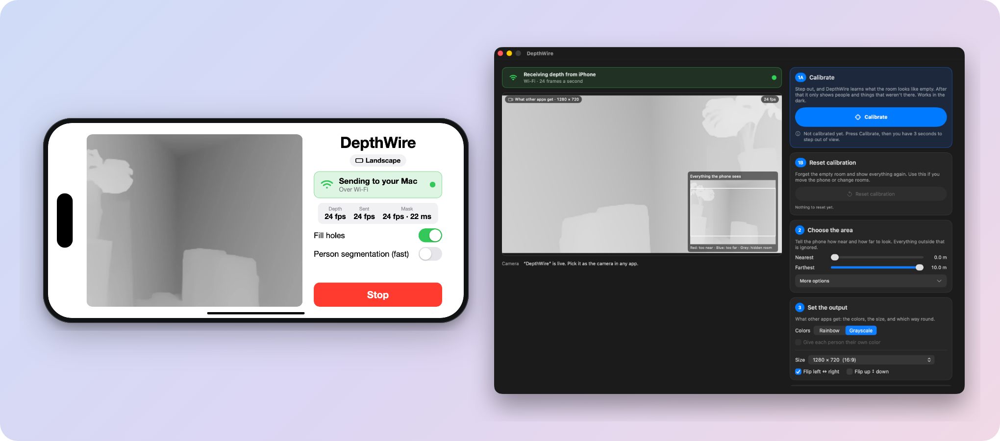
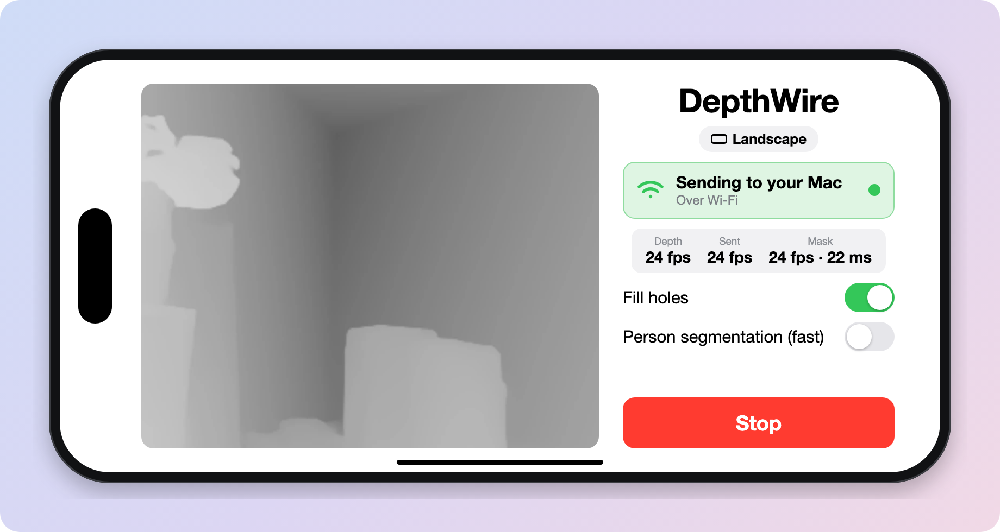
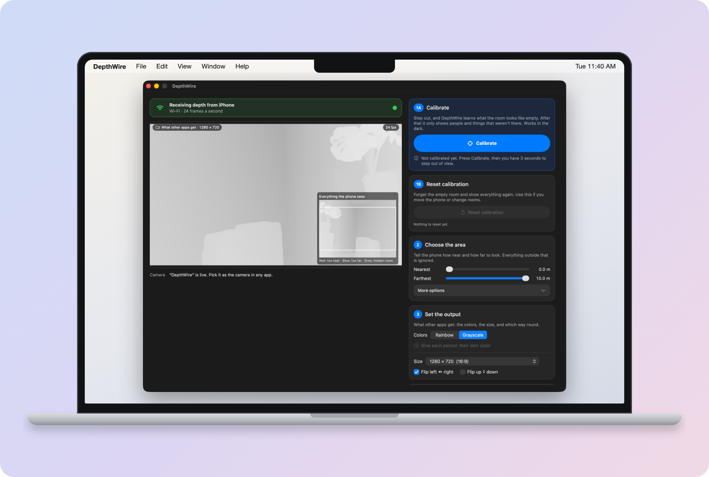
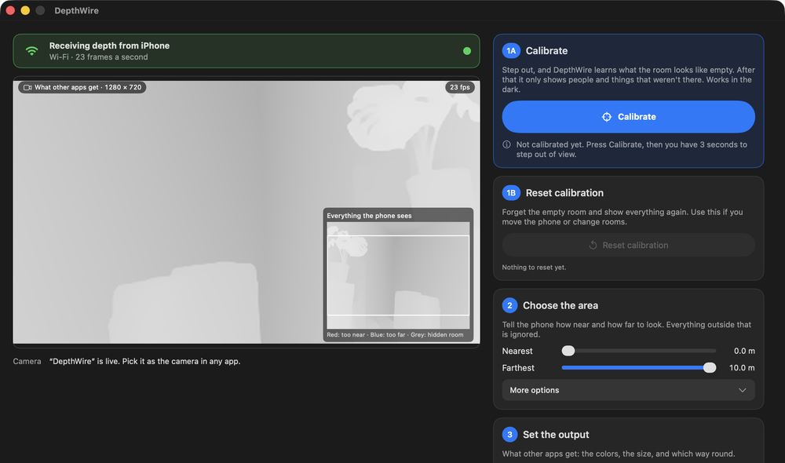
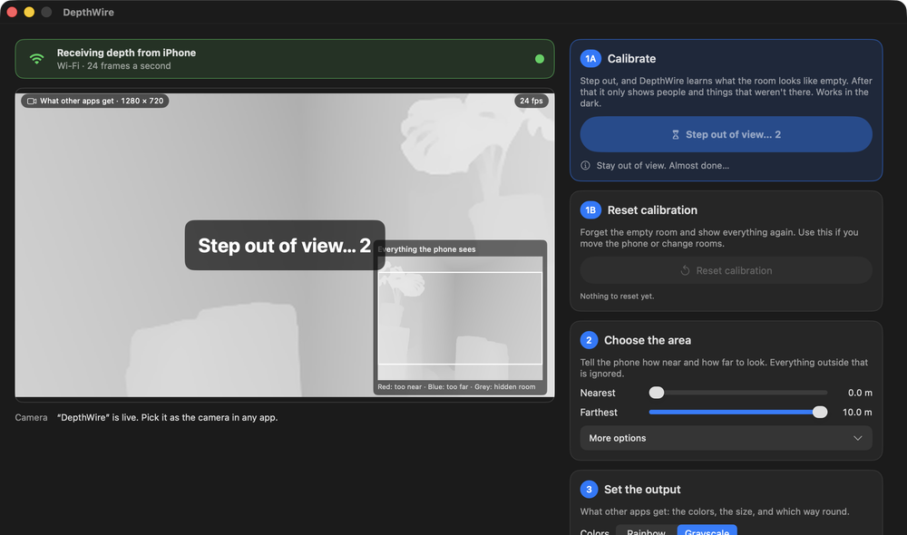
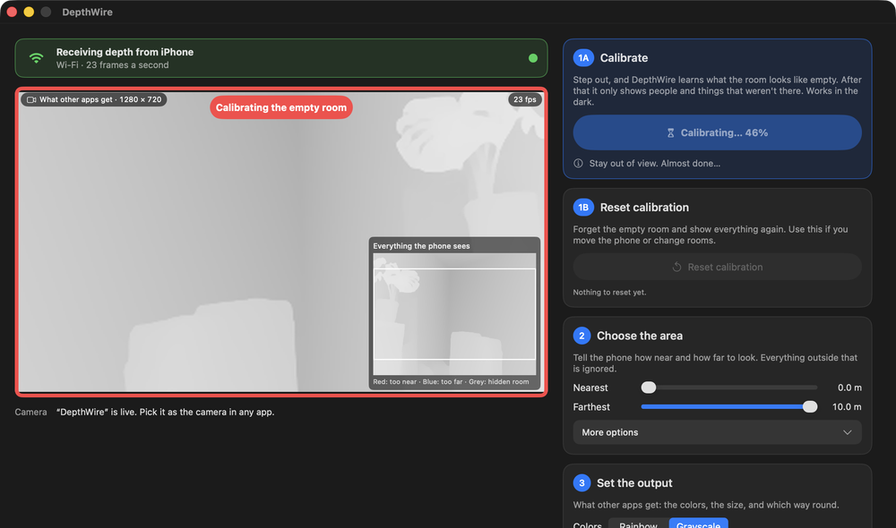
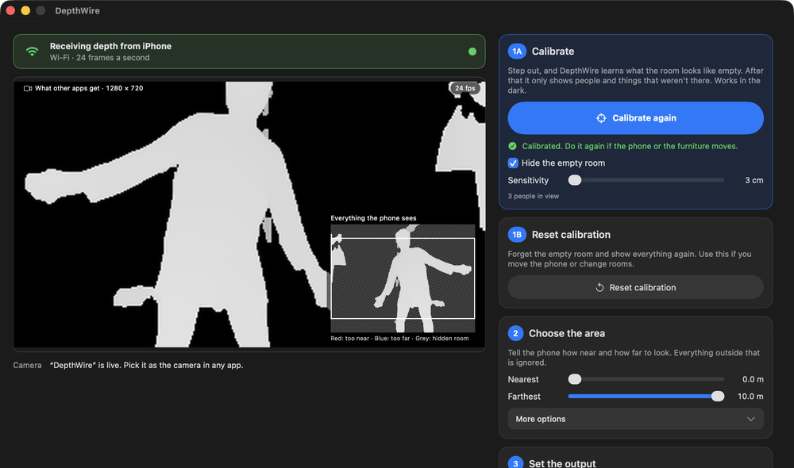
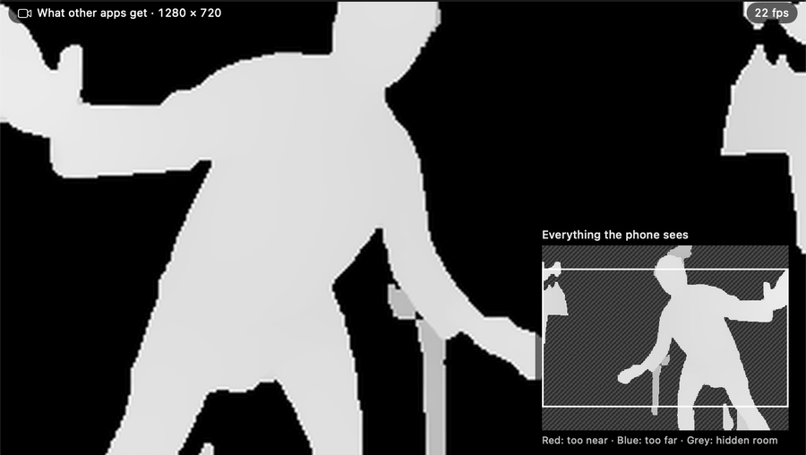

<h1 align="center">DepthWire</h1>

<b>Make interactive installs with the phone you already have.</b> 
An iPhone's LiDAR instead of a Kinect: the apps, the gear, the room setup and the visuals.

  

  
  

---

## 1 · What you need

- **An iPhone with LiDAR** (12 Pro or any later Pro)
- **A Mac**
- **A tripod** for the phone
- **A projector**

That's it for Wi-Fi. For shows that run for hours, add two Ethernet adapters and a long cable, about $70 in all.

→ [The full gear list, with models and prices](guide/gear.md)

## 2 · Get the apps talking

1. **Mac:** install [DepthWire for Mac](https://github.com/IsaacSante/depthwire/releases) and approve its camera.
2. **iPhone:** open DepthWire on the same Wi-Fi.
3. The Mac shows a green **Receiving depth** banner, and the room appears.
4. Pick **DepthWire** as the camera in any app.

The iPhone app isn't on the App Store yet. For now, [build it with Xcode](docs/development.md).

## 3 · Set up the room

Place the phone on the tripod, low, facing the people. Then calibrate:

<table>
<tr>
<td width="50%"> <b>1. Start.</b> The phone sees the whole room.</td>
<td width="50%"> <b>2. Press Calibrate</b> and step out of view. You get 3 seconds.</td>
</tr>
<tr>
<td> <b>3. Wait for the red frame.</b> It learns the empty room in about a second.</td>
<td> <b>4. Walk in.</b> The room is gone. Only you show up.</td>
</tr>
</table>

Then set how near and how far to look. It works in the dark.

→ [Watch the whole flow](media/app-calibrate.gif) · [Room setup guide](guide/room-setup.md)

## 4 · Make visuals

This is what your visuals get: only what wasn't in the empty room. White is near, dark is far.

In **TouchDesigner**, add a Video Device In TOP and pick DepthWire. Paste in a starter and build from there.

→ [TouchDesigner starters](touchdesigner/)

## 5 · Run a show

<table><tr>
<td width="270"></td>
<td>

- **Use a cable** for anything that runs for hours.
- **Keep the phone charging** through its adapter.
- **Calibrate with the room empty** before the doors open.
- **Walk the whole area** and watch the edges.

→ [Show checklist and fixes](guide/run-a-show.md)

</td>
</tr></table>

---

  <a href="docs/development.md">Build from source</a> ·
  <a href="guide/run-a-show.md#if-it-stops">Troubleshooting</a> ·
  <a href="LICENSE">MIT license</a>, free for anything

